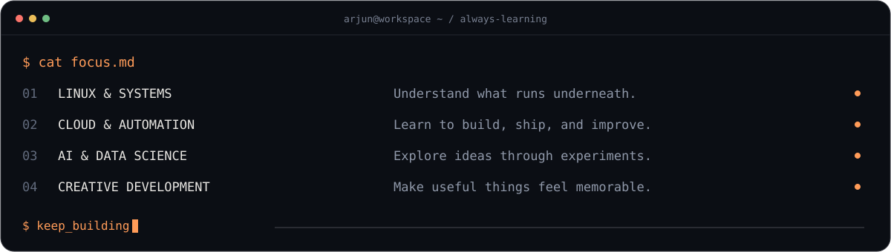
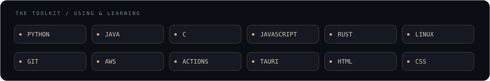

**AI & Data Science student · Aspiring Cloud & DevOps Engineer**

[Portfolio](https://arjundineshmenon.github.io/Portfolio/) &nbsp; / &nbsp; [LinkedIn](https://www.linkedin.com/in/arjun-dinesh-3b0923253/) &nbsp; / &nbsp; [Explore my repositories](https://github.com/ArjunDineshMenon?tab=repositories)

## Hey, I'm Arjun 👋

I'm studying **B.Tech in Artificial Intelligence & Data Science** at **KGISL Institute of Technology**, with a focus on **Cloud & DevOps**. I enjoy understanding how systems work, turning ideas into working software, and making the experience feel polished.

My interests connect **Linux, automation, cloud infrastructure, AI, and interactive web development**. This profile is a record of what I build, what I learn, and how I improve along the way.

## My contribution orbit

Activity snapshot captured on October 22, 2026. The live GitHub contribution chart is below the README.

## Explore my work

| Repository | What you'll find |
| --- | --- |
| [**Portfolio**](https://github.com/ArjunDineshMenon/Portfolio) | My personal website and experiments with interactive web experiences. |
| [**DevOps Notes**](https://github.com/ArjunDineshMenon/DevOps-Notes) | Notes from my Cloud & DevOps learning journey. |
| [**LeetCode Problems**](https://github.com/ArjunDineshMenon/LeetCode-Problems) | Coding practice focused on problem solving, data structures, and algorithms. |
| [**Text-to-Speech Web App**](https://github.com/ArjunDineshMenon/Text-to-Speech-webapp) | A web application project exploring text-to-speech. |

## What I'm focused on

- **Cloud & DevOps:** strengthening Linux, Git, AWS, and CI/CD fundamentals.
- **Software development:** building useful tools and improving how I structure and debug code.
- **AI & Data Science:** connecting coursework with practical experiments.
- **Creative development:** exploring animation, 3D websites, and game development.

## My toolkit

**Languages I use and study**

`Python` · `Java` · `C` · `JavaScript` · `Rust`

**Tools & technologies I'm working with or learning**

`Linux` · `Git & GitHub` · `AWS` · `GitHub Actions` · `Tauri` · `HTML & CSS`

## Let's connect

I'm interested in collaborating on **student projects, developer tools, cloud experiments, and creative web experiences**. If you're building something in those areas, [connect with me on LinkedIn](https://www.linkedin.com/in/arjun-dinesh-3b0923253/).

Always learning. Always building.

